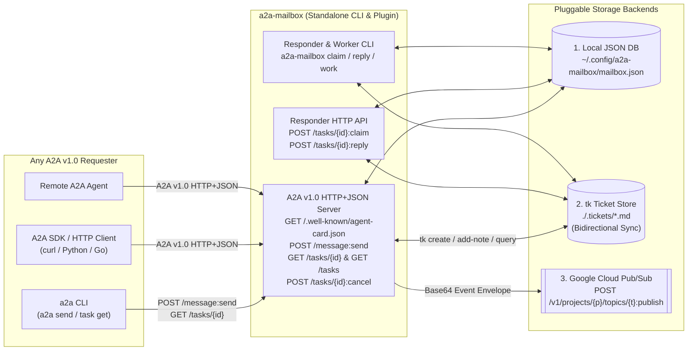
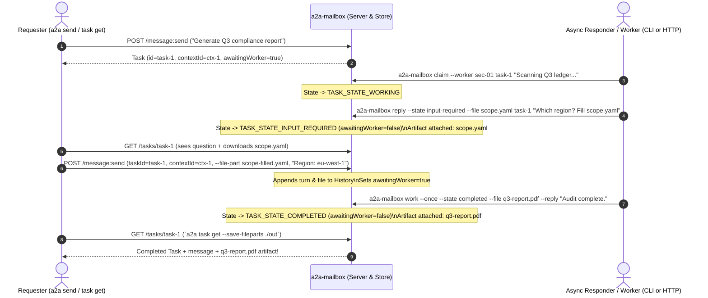
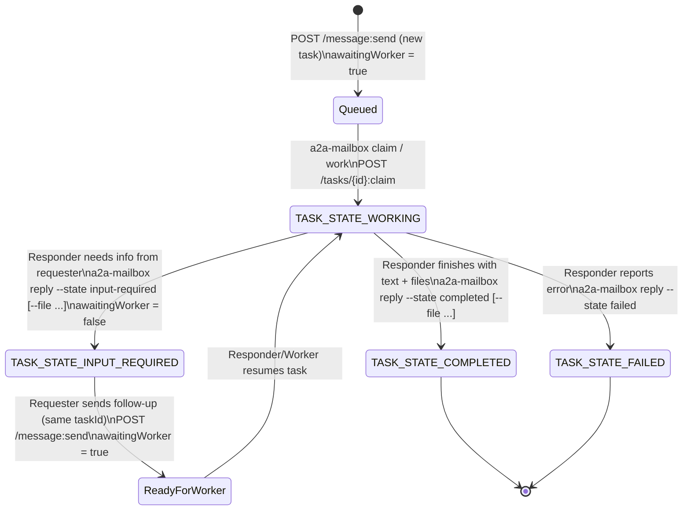
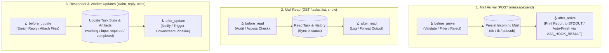

# a2a-mailbox

[](https://github.com/msampathkumar/a2a-mailbox/releases)
[](https://go.dev/)
[](https://a2a-protocol.org/)
[](./LICENSE)

**`a2a-mailbox`** is a standalone **executor-less A2A v1.0 HTTP+JSON Inbox Server, Asynchronous Responder/Worker, and `a2a` CLI Command Plugin** (`a2a mailbox`).

Standard A2A servers couple the HTTP protocol transport directly to an inline agent executor. **`a2a-mailbox` decouples task reception from task execution**:
- **Inbox Server (`serve`)**: Exposes a compliant A2A v1.0 endpoint (`/.well-known/agent-card.json`, `POST /message:send`, `GET /tasks/{id}`, `GET /tasks`, `POST /tasks/{id}:cancel`), registers incoming requests (including text, file, and data parts), and persists them into a pluggable backend (`db`, `tk`, or `pubsub`).
- **Async Responders & Workers (`claim`, `reply`, `work`, and HTTP `:claim` / `:reply`)**: Allows human operators, background scripts, or autonomous worker daemons to claim queued tasks (`TASK_STATE_WORKING`), **request additional clarification from the requester (`TASK_STATE_INPUT_REQUIRED`)**, attach new files/artifacts (`--file`, `--file-url`), and complete tasks (`TASK_STATE_COMPLETED`) asynchronously.

---

## Pluggable Storage Backends

1. **`db` (Local JSON Database)**: Zero-dependency, atomic local JSON store (`~/.config/a2a-mailbox/mailbox.json`).
2. **`tk` (`tk` Ticket Tool)**: Automatically creates a markdown ticket in `.tickets/` (`tk create`) when a new A2A task arrives, logs responder updates & attached filenames (`tk add-note`), and **bidirectionally syncs ticket status** (`open` / `in_progress` / `closed` <-> `TASK_STATE_INPUT_REQUIRED` / `TASK_STATE_WORKING` / `TASK_STATE_COMPLETED`).
3. **`pubsub` (Google Cloud Pub/Sub)**: Publishes structured A2A event envelopes (`a2a.mailbox.message_received`, `a2a.mailbox.task_replied`) to `POST /v1/projects/{project}/topics/{topic}:publish` for production event-driven pipelines.

---

## Architecture & Workflows

### 1. Standalone System Architecture (Inbox + Responders/Workers)



### 2. Async Worker Lifecycle: Claim, Request Clarification (`input-required`), Attach Files & Complete

When a responder or worker needs more information from the requester, it transitions the task to `TASK_STATE_INPUT_REQUIRED` (optionally attaching a template or checklist file). When the requester replies on the same `taskId`, the mailbox sets `awaitingWorker=true` so the worker can resume and complete the task with final output files:



### 3. Task State & Worker Synchronization



### 4. Lifecycle Hooks Pipeline (`before_*` & `after_*`)

Every mailbox operation and responder/worker update passes through 6 customizable lifecycle hooks configured via `.env` or CLI flags:



---

## `.env` Configuration & Python Report Responder Demo

`a2a-mailbox` automatically loads `.env` (or `--env-file <path>`) organized into three sections: **`[a2a-mailbox]`**, **`[workers]`**, and **`[hooks]`** (see [`.env.example`](./.env.example)):

```ini
# ============================================================================
# [a2a-mailbox] — Standalone Inbox Server Configuration
# ============================================================================
A2A_MAILBOX_HOST=127.0.0.1
A2A_MAILBOX_PORT=8085
A2A_MAILBOX_BACKEND=db
A2A_MAILBOX_DB_PATH=./mailbox.json

# ============================================================================
# [workers] — Asynchronous Responder & Background Worker Configuration
# ============================================================================
A2A_WORKER_ID=python-report-responder
A2A_WORKER_STATE=completed
A2A_WORKER_EXEC="python3 ./examples/report_responder.py"

# ============================================================================
# [hooks] — Mailbox & Responder Lifecycle Hooks
# ============================================================================
A2A_HOOK_BEFORE_ARRIVE=""
A2A_HOOK_AFTER_ARRIVE="python3 ./examples/report_responder.py"
A2A_HOOK_BEFORE_READ=""
A2A_HOOK_AFTER_READ=""
A2A_HOOK_BEFORE_UPDATE=""
A2A_HOOK_AFTER_UPDATE=""
```

### Live Demo: Python Auto-Report & Task Completion ([`examples/report_responder.py`](./examples/report_responder.py))

When `A2A_HOOK_AFTER_ARRIVE="python3 ./examples/report_responder.py"` is set in `.env`:
1. Start the mailbox server:
   ```bash
   cp .env.example .env
   a2a-mailbox serve --env-file .env
   ```
2. Send a message from any A2A client:
   ```bash
   a2a send -a http://127.0.0.1:8085 "Generate executive summary for Q4 AI agent adoption across 8 teams"
   ```
3. Immediately on arrival, `examples/report_responder.py` reads the mail payload, prints a formatted report to **`STDOUT`**, attaches a Markdown report artifact (`report-<task-id>.md`), and finishes the task (`TASK_STATE_COMPLETED`):
   ```text
   ╭────────────────────────────────────────────────────────────────────╮
   │                📬 A2A-MAILBOX INCOMING MAIL REPORT                 │
   ├────────────────────────────────────────────────────────────────────┤
   │ Timestamp (UTC) : 2026-10-17 00:55:49Z                             │
   │ Trigger Event   : after_arrive                                     │
   │ Task ID         : task-8f3c1b20a9e1                                │
   │ Context ID      : ctx-4d91e07c11b2                                 │
   │ Conversation #  : Turn 1                                           │
   │ Word Count      : 11                                               │
   ├────────────────────────────────────────────────────────────────────┤
   │ Message Content :                                                  │
   │   Generate executive summary for Q4 AI agent adoption across 8 teams │
   ├────────────────────────────────────────────────────────────────────┤
   │ Action Taken    : Report printed to STDOUT & Task COMPLETED        │
   ╰────────────────────────────────────────────────────────────────────╯
   ```

---

## Installation

### Build & Install Standalone Binary
```bash
git clone https://github.com/msampathkumar/a2a-mailbox.git
cd a2a-mailbox
make install
```

### Use as an `a2a` CLI Command Plugin
When `a2a-mailbox` is on your `PATH`, the `a2a` CLI automatically discovers it as `a2a mailbox`:
```bash
a2a plugin set-enabled true
a2a plugin list
```

```text
Command plugins: enabled
NAME     VERSION  DESCRIPTION                                                                                 PATH
mailbox  0.1.0    Executor-less A2A inbox server & async responder backed by local DB, tk tickets, or Pub/Sub /opt/homebrew/bin/a2a-mailbox
```

---

## Quick Start

### 1. Start the Mailbox Server

```bash
# Local JSON database backend (default, listens on http://127.0.0.1:8085)
a2a-mailbox serve --port 8085 --backend db

# `tk` ticket backend (creates and syncs tickets in ./.tickets)
a2a-mailbox serve --port 8085 --backend tk --tk-dir .

# Production Google Cloud Pub/Sub backend
export GOOGLE_CLOUD_PROJECT="my-gcp-project"
export PUBSUB_BEARER_TOKEN="$(gcloud auth print-access-token)"
a2a-mailbox serve --port 8085 --backend pubsub --pubsub-topic a2a-inbox
```

### 2. Send Requests from Any A2A Client

```bash
# Inspect the mailbox Agent Card
a2a card get http://127.0.0.1:8085

# Send a request into the mailbox
a2a send -a http://127.0.0.1:8085 "Generate security audit for cluster-9"
```

### 3. Responder Workflows: Claim, Ask for Info, Attach Files & Complete

```bash
# 1. List queued tasks
a2a-mailbox list

# 2. Claim a task as WORKING
a2a-mailbox claim --worker sec-bot-1 <task-id> "Claimed task; scanning cluster-9..."

# 3. Need more info from the requester? Transition to input-required (with optional template file)
a2a-mailbox reply --worker sec-bot-1 --state input-required --file ./checklist.md <task-id> \
  "Please confirm the target namespace in checklist.md and reply."

# 4. Complete the task with text + output files (saved as A2A Artifacts)
a2a-mailbox reply --worker sec-bot-1 --state completed --file ./audit-report.pdf --file ./metrics.json <task-id> \
  "Security audit complete. Reports attached."
```

### 4. Run an Autonomous Background Worker (`a2a-mailbox work`)

You can also run `a2a-mailbox work` continuously (or `--once` in cron/CI) to automatically process tasks where `awaitingWorker=true`:

```bash
# Process all currently actionable tasks once with a static/template reply + file
a2a-mailbox work --once --worker auto-responder --state completed --file ./summary.txt --reply "Processed batch."

# Or run a continuous background worker invoking a custom handler binary for each task:
# (Passes A2A_TASK_ID, A2A_CONTEXT_ID, A2A_MESSAGE_TEXT, and A2A_TASK_JSON in env)
a2a-mailbox work --interval 2s --worker custom-agent --exec /usr/local/bin/my-task-handler
```

If the `--exec` binary outputs JSON (`{"state": "input-required|completed|working", "text": "...", "files": [{"filename": "...", "raw": "<base64>"}]}`), `a2a-mailbox work` applies that exact state transition and file attachments; otherwise it uses stdout as the reply text.

---

## Subcommands & HTTP Endpoints Reference

| CLI Subcommand | Key Flags | Description |
| :--- | :--- | :--- |
| `serve` | `--host 127.0.0.1`, `--port 8085`, `--backend db\|tk\|pubsub`, `--db`, `--tk-dir`, `--pubsub-project`, `--pubsub-topic`, `--ack-state` | Run the executor-less A2A v1.0 HTTP+JSON inbox server |
| `list` | `--backend db\|tk`, `--db`, `--tk-dir`, `--context <id>`, `--status <state>` | List stored tasks with `contextId`, state, and `tk` ticket ID |
| `show <task-id>` | `--backend db\|tk`, `--db`, `--tk-dir` | Print the full A2A `Task` JSON (syncing status from `tk` if enabled) |
| `claim <task-id> [msg]` | `--backend db\|tk`, `--db`, `--tk-dir`, `--worker <id>` | Transition a task to `TASK_STATE_WORKING` and record `workerId` |
| `reply <task-id> <text>` | `--backend db\|tk`, `--db`, `--tk-dir`, `--state working\|input-required\|completed\|failed`, `--file <path>`, `--file-url <url>`, `--worker <id>` | Post a status update, ask the requester for info, or complete with attached files |
| `work` | `--once`, `--interval 2s`, `--worker <id>`, `--exec <bin>`, `--state <state>`, `--file <path>`, `--reply <text>` | Poll and process actionable tasks (`awaitingWorker=true`) automatically |
| `info` | *(none)* | Print `a2a` Command Plugin metadata JSON |

| HTTP Endpoint | Method | Role | Description |
| :--- | :--- | :--- | :--- |
| `/.well-known/agent-card.json` | `GET` | Requester | Returns A2A v1.0 Agent Card |
| `/message:send` | `POST` | Requester | Registers new task or appends follow-up turn (text, file, or data parts) |
| `/tasks/{id}` | `GET` | Requester / Responder | Retrieves task status, conversation history, and file artifacts |
| `/tasks` | `GET` | Requester / Responder | Lists tasks filtered by `contextId` and `status` |
| `/tasks/{id}:cancel` | `POST` | Requester | Cancels an active task (`TASK_STATE_CANCELED`) |
| `/tasks/{id}:claim` | `POST` | Responder | Claims a task (`TASK_STATE_WORKING`) with `{ "workerId": "...", "text": "..." }` |
| `/tasks/{id}:reply` | `POST` | Responder | Updates a task with `{ "state": "...", "text": "...", "files": [...] }` |

---

## Testing & Black-Box Evals

Run all unit, integration, and compiled-binary black-box evaluation tests with the Go race detector enabled:

```bash
make test
# or:
go test -v -count=1 -race ./...
```

---

## License

Licensed under the [Apache License, Version 2.0](./LICENSE).
