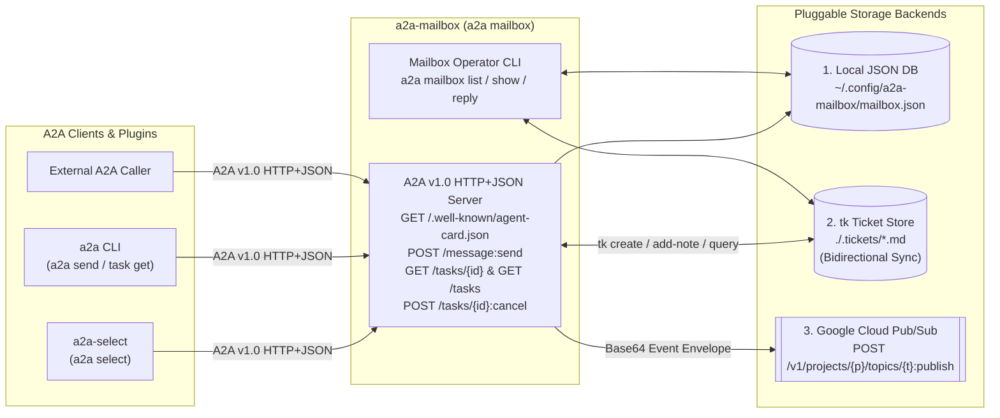
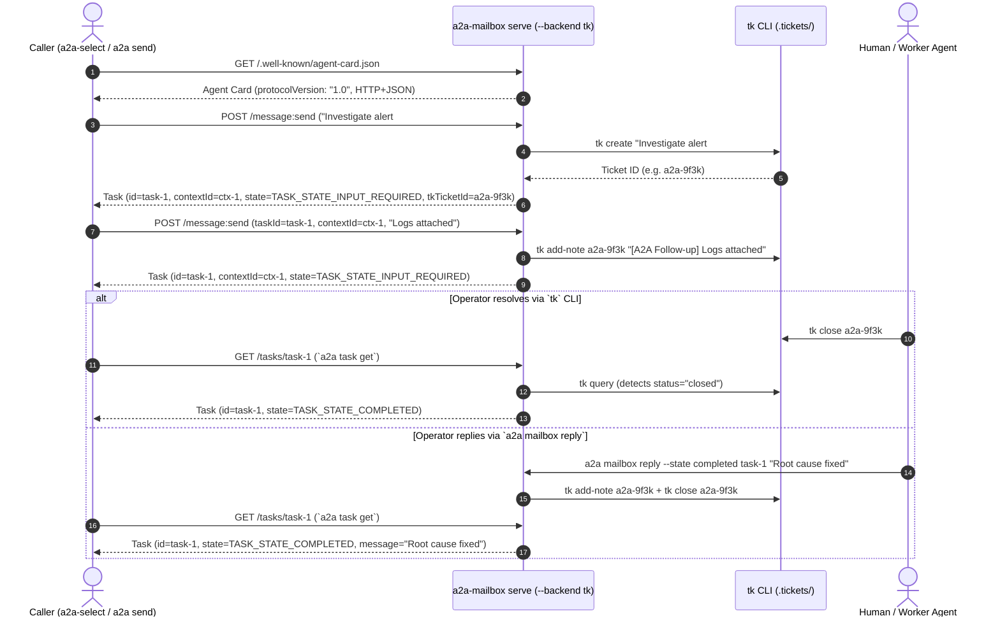
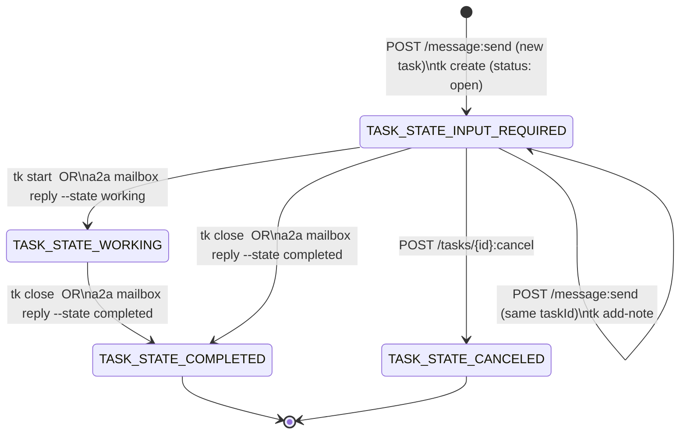

# a2a-mailbox

[](https://github.com/msampathkumar/a2a-mailbox/releases)
[](https://go.dev/)
[](https://a2a-protocol.org/)
[](./LICENSE)

**`a2a-mailbox`** is an **executor-less A2A v1.0 HTTP+JSON Server** and **`a2a` CLI Command Plugin** (`a2a mailbox`).

Instead of running an inline LLM or agent executor, `a2a-mailbox` acts as a **decoupled, durable A2A inbox/queue**. Its sole job is to serve a compliant `/.well-known/agent-card.json`, receive incoming A2A requests (`POST /message:send`, `GET /tasks/{id}`, `GET /tasks`, `POST /tasks/{id}:cancel`), assign and preserve `taskId` and `contextId`, and persist every task into one of three pluggable backends:

1. **`db` (Local JSON Database)**: Atomic, zero-dependency local JSON file store (`~/.config/a2a-mailbox/mailbox.json`).
2. **`tk` (`tk` Ticket Tool)**: Automatically creates a markdown ticket in `.tickets/` (`tk create`) when a new A2A task arrives, appends follow-up turns (`tk add-note`), and **bidirectionally syncs ticket status** — closing a ticket with `tk close <ticket-id>` automatically transitions the A2A task to `TASK_STATE_COMPLETED` when queried via `a2a task get`!
3. **`pubsub` (Google Cloud Pub/Sub)**: Publishes structured A2A event envelopes (`a2a.mailbox.message_received`, `a2a.mailbox.task_replied`) to `POST /v1/projects/{project}/topics/{topic}:publish` for production event-driven pipelines.

It works seamlessly alongside [**`a2a-select`**](https://github.com/msampathkumar/a2a-select) both as a sibling `a2a` plugin (`a2a mailbox` + `a2a select`) and over the A2A wire protocol (`a2a-select` chatting with `a2a-mailbox`).

---

## Architecture & Workflows

### 1. System Architecture (`a2a-select` + `a2a-mailbox` + Pluggable Backends)



### 2. Bidirectional `tk` Ticket & A2A Task Sequence



### 3. Task State Synchronization



---

## Installation

### Install via `Makefile`
```bash
git clone https://github.com/msampathkumar/a2a-mailbox.git
cd a2a-mailbox
make install
```

### Enable as an `a2a` Command Plugin
```bash
a2a plugin set-enabled true
a2a plugin list
```

Output:
```text
Command plugins: enabled
NAME     VERSION  DESCRIPTION                                                                     PATH
mailbox  0.1.0    Executor-less A2A inbox server backed by local DB, tk tickets, or Pub/Sub       /opt/homebrew/bin/a2a-mailbox
select   0.1.0    Interactive agent card selector, ARDS discovery, and stateful A2A chat session  /opt/homebrew/bin/a2a-select
```

---

## Quick Start

### 1. Start the Executor-less A2A Mailbox Server

#### Option A: Local JSON Database Backend (Default)
```bash
a2a mailbox serve --port 8085 --backend db
```

#### Option B: `tk` Ticket Backend (`.tickets/` Directory)
```bash
a2a mailbox serve --port 8085 --backend tk --tk-dir .
```

#### Option C: Production Google Cloud Pub/Sub Backend
```bash
export GOOGLE_CLOUD_PROJECT="my-gcp-project"
export PUBSUB_BEARER_TOKEN="$(gcloud auth print-access-token)"
a2a mailbox serve --port 8085 --backend pubsub --pubsub-topic a2a-inbox
```

### 2. Send Tasks with `a2a` or Chat Interactively with `a2a-select`

```bash
# Inspect the mailbox Agent Card
a2a card get http://127.0.0.1:8085

# Send a task into the mailbox
a2a send -a http://127.0.0.1:8085 "Approve purchase order #77"

# Or connect interactively with a2a-select
a2a select
```

### 3. Inspect & Reply to Queued Tasks

```bash
# List queued tasks (with Context ID, State, and tk Ticket ID)
a2a mailbox list

# Inspect full A2A Task JSON and conversation history
a2a mailbox show <task-id>

# Reply and transition task state (completed | input-required | working)
a2a mailbox reply --state completed <task-id> "PO #77 approved and processed."
```

---

## Subcommands & Flags Reference

| Subcommand | Key Flags | Description |
| :--- | :--- | :--- |
| `serve` | `--host 127.0.0.1`, `--port 8085`, `--backend db\|tk\|pubsub`, `--db`, `--tk-dir`, `--pubsub-project`, `--pubsub-topic`, `--ack-state` | Run the executor-less A2A v1.0 HTTP+JSON inbox server |
| `list` | `--backend db\|tk`, `--db`, `--tk-dir`, `--context <id>`, `--status <state>` | List stored tasks with `contextId`, state, and `tk` ticket ID |
| `show <task-id>` | `--backend db\|tk`, `--db`, `--tk-dir` | Print the full A2A `Task` JSON (syncing status from `tk` if enabled) |
| `reply <task-id> <text>` | `--backend db\|tk`, `--db`, `--tk-dir`, `--state completed\|input-required\|working` | Append an agent reply, update task state, and sync `tk` / Pub/Sub |
| `info` | *(none)* | Print `a2a` Command Plugin metadata JSON |

---

## Testing & Black-Box Evals

Run all unit, integration, and compiled-binary black-box evaluation tests with the Go race detector enabled:

```bash
make test
# or:
go test -v -count=1 -race ./...
```

---

## License

Licensed under the [Apache License, Version 2.0](./LICENSE).
